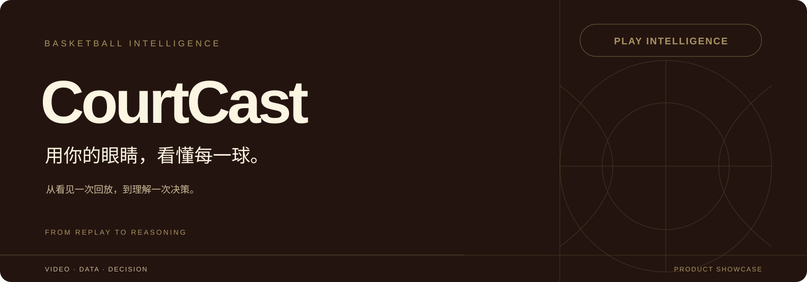
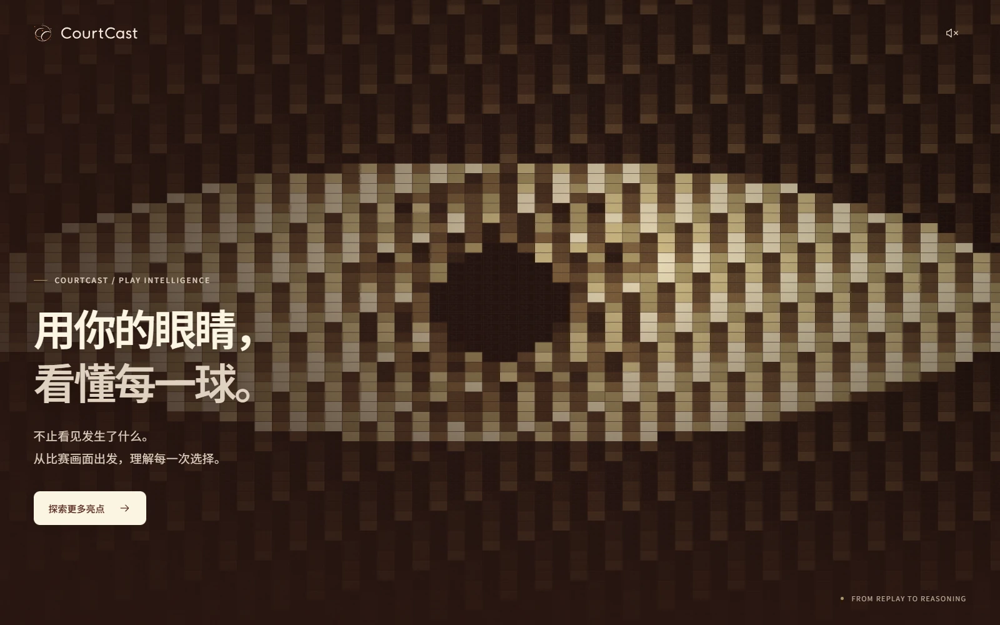
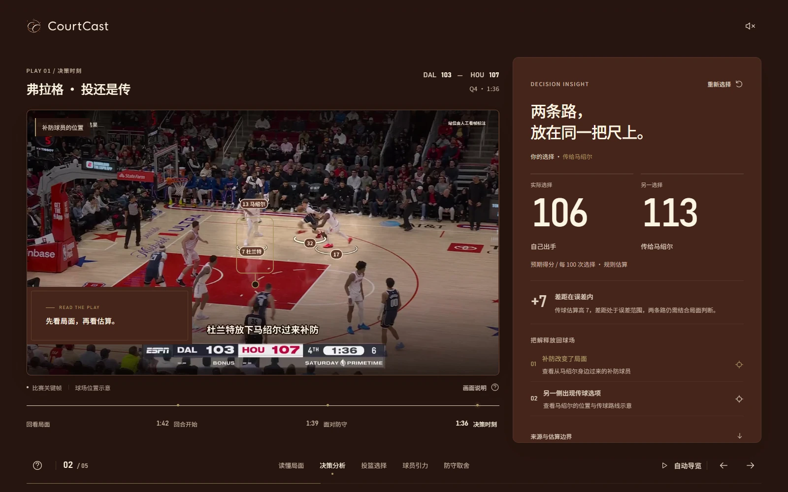
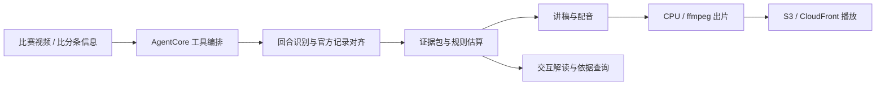

<p align="center">
  
</p>

<p align="center">
  
  
  
</p>

<h3 align="center">让一次回放，成为一次理解比赛的机会。</h3>

<p align="center">
  <a href="https://lavine888.github.io/CourtCast-Showcase/">体验原版 v6 前端 ↗</a> ·
  <a href="#产品理念">产品理念</a> ·
  <a href="#核心能力">核心能力</a> ·
  <a href="docs/PRODUCT.md">产品详解</a> ·
  <a href="docs/ARCHITECTURE.md">技术架构</a>
</p>

---

## 一件获奖作品，一种看球方式

**CourtCast 是 Team 15 在 NBA × AWS「深度赛场」黑客松中完成的 AI 篮球解说产品，获得比赛铜奖。**

给它一段比赛视频，CourtCast 把比赛画面、官方记录和分析依据连接起来，解释一次突破为什么吸引补防、另一侧为什么出现空位，以及一次选择意味着什么，再将这些信息组织成听得懂的配音讲解片。

这个仓库记录团队的产品理念、功能设计与技术方案，并保留比赛期间持续迭代的 **v6 前端页面**：原眼睛拼图、比赛样例图片、文案与交互均沿用当时版本。

> **看见，是转播给的；看懂，是 CourtCast 补上的。**

## 产品理念

同一个回合里，持球人看到空位，防守人看到威胁，教练看到取舍，观众往往先看到进没进。

CourtCast 想把这些视角连接起来：让普通球迷也能读懂专业分析中的空间、对位与决策，而不用先理解一整张复杂的数据表。

我们把一球拆成三个问题：

| 机会 | 选择 | 结果 |
| :--- | :--- | :--- |
| 防守怎么移动？机会在哪里形成？ | 为什么出手、传球或突破？ | 这一球最终发生了什么？ |
| 看站位、空间、牵引与出手环境 | 在同一尺度上比较可行选项 | 把结果与选择质量分开阅读 |

**投进不自动代表选择正确，投丢也不自动代表选择错误。** 判断需要回到那一刻的局面与依据。

## 体验预览

### 从「眼睛」进入比赛

用比赛画面拼成一只眼睛，镜头推进到其中一个回合。暖金、深棕与象牙白贯穿开场、分析和收尾，呈现复古球馆与赛事画册的质感。



### 先做判断，再揭晓依据

面对补防，先选「自己突破出手」或「传给空位队友」，再看分析如何解释两条路线。点击分析依据，球场上的位置与传球路线随之显现。



<sub>上图直接截取本仓库的原版 v6 页面，使用当时的比赛样例关键帧。球员框线和传球路线为位置示意；106 / 113 等数字来自既有分析样例，页面不重新执行在线识别或推理。</sub>

## 核心能力

| 能力 | CourtCast 怎么做 | 带来的价值 |
| :--- | :--- | :--- |
| **找到这一球** | 读取比赛视频中的比分条信息，与官方逐回合记录交叉匹配 | 让人名、比分、时刻与结果回到同一个真实回合 |
| **解释关键选择** | 将出手环境、预期命中率和规则估算放回比赛局面 | 从「发生了什么」走向「为什么这样选」 |
| **生成配音讲解片** | 先看原速，再围绕关键时刻拆解；字幕、标注与解说按时刻组织 | 保留看球节奏，也给复杂信息留出理解空间 |
| **把数字连回依据** | 区分官方记录、官方深度数据、规则估算与人工观察 | 让观众知道每个数字和判断来自哪里 |
| **切换分析视角** | 以进攻、防守、教练取舍组织训练样例与交互设计 | 同一个篮球问题，有多种值得理解的角度 |
| **让观众参与判断** | 先选路线，再揭晓对比；支持回看与球场位置联动 | 从被动看解说，变成主动理解一次决策 |

### 一个例子：弗拉格，该投还是传？

路演样例给出两种选择的规则估算：

| 自己出手 | 传给另一侧空位的马绍尔 |
| :---: | :---: |
| **106** | **113** |

单位为每 100 次选择的预期得分。差距是 **7**，处于该样例的误差范围内。CourtCast 展示差异、补防位置与传球条件，**不把这个差距包装成「传球一定更好」的结论**。

这也是产品最核心的态度：**解释选择，并尊重证据。**

## 让分析值得相信

- **先对齐，再讲解。** 认出比赛、节次和时钟，将模型读取的信息与官方记录核对。
- **先看片，再拆解。** 先让观众完整看到回合，再解释关键时刻，减少碎片化的停顿。
- **每个数字有来源。** 官方记录、官方深度数据、规则估算、人工观察分别表达。
- **结论与误差一起出现。** 数值差异不足以支撑判断时，保留依据和条件，不强行评判对错。
- **表达服务于理解。** 用开头的问题和结尾的回答串起因果，让图表与动效帮助观众看懂比赛。

## 技术路线

团队比赛方案围绕 **Amazon Bedrock AgentCore** 组织工具调用，将认球、取数、估算、讲稿和出片串成一条工作流：



| 模块 | 团队比赛方案 |
| :--- | :--- |
| Agent 工具 | `identify_play` · `find_play` · `make_film` · `read_film` |
| 编排与计算 | Bedrock AgentCore · Lambda · EventBridge · SQS · DynamoDB |
| 数据与分析 | 官方逐回合记录 · 深度数据 · 规则估算 · 胜率分析 |
| 讲稿与成片 | 讲稿检查 · Gemini / Polly 配音 · ffmpeg CPU 渲染 |
| 交付 | S3 · CloudFront · AWS CDK |
| v6 前端展示 | HTML · CSS · JavaScript · Canvas · SVG |

完整设计见 [技术架构](docs/ARCHITECTURE.md)；产品取舍、数据口径和后续方向见 [产品详解](docs/PRODUCT.md)。

## 在本地打开

**无需安装依赖或构建。**

1. 下载仓库 ZIP，并完整解压。
2. 双击最外层的 `index.html`，即可进入原版 v6 前端。
3. 点击「探索更多亮点」，用滚轮、左右键或底部章节切换五个亮点。

也可以在仓库目录启动静态服务：

```bash
python -m http.server 8765
```

打开 <http://127.0.0.1:8765/>。

交互原型支持选择与揭晓、依据标注、关键时刻回看、自动导览、声音开关、键盘导航，以及系统的「减少动态效果」设置。

## 仓库导览

```text
CourtCast-Showcase/
├── README.md                 # 获奖作品与产品介绍
├── index.html                # 双击打开的展示入口
├── demo/                     # 当时迭代的原版 v6 前端
│   ├── index.html
│   ├── demo-data.js
│   ├── experience.js
│   ├── experience.css
│   └── assets/               # 比赛样例图片、眼睛拼图、标志与字体
├── 首屏视觉稿/               # 原片尾跳转页面与已有图片
└── docs/
    ├── PRODUCT.md            # 产品理念、能力与设计取舍
    ├── ARCHITECTURE.md       # 团队比赛方案与公开版边界
    └── media/                # 封面与原版页面截图
```

## 关于这份公开展示

这是 **Team 15 团队获奖作品的展示仓库**。这里直接保留原版 v6 前端的观众选择、分析对比和视觉叙事；比赛视频识别、官方数据查询、配音与出片由团队的云端服务承担，不随静态页面在浏览器中执行。

本仓库包含原版前端所使用的比赛样例图片与眼睛拼图，不附带原始比赛录像、第三方模型权重或云端凭据。图中既有标注与规则估算的来源、条件和误差继续保留。片尾沿用原来的跳转与外链；旧目标页所需的两段 MP4 未包含在原素材中。

项目为独立比赛作品。NBA 标识、赛事资料及其他第三方素材的权利归各自所有者；公开展示不等同于授予项目或第三方素材的再分发许可。Noto Sans SC 字体按 [SIL OFL](demo/assets/fonts/OFL.txt) 分发。
