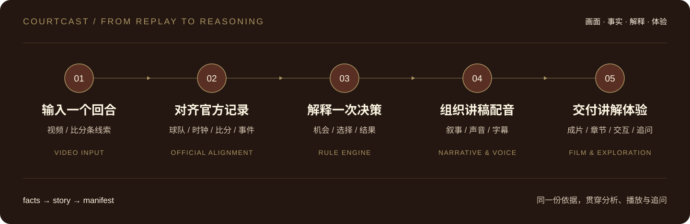

<p align="center">
  
</p>

<h3 align="center">从观看一次回放，到理解一次决策。</h3>

<p align="center">
  视频理解 · 篮球决策分析 · 配音讲解 · 交互探索
</p>

<p align="center">
  <a href="https://lavine888.github.io/CourtCast-Showcase/"><strong>立即体验 ↗</strong></a> ·
  <a href="#看懂比赛的另一层">产品理念</a> ·
  <a href="#courtcast-能做什么">核心能力</a> ·
  <a href="docs/PRODUCT.md">深入了解</a> ·
  <a href="docs/ARCHITECTURE.md">技术架构</a>
</p>

---

**CourtCast 是一款将比赛视频、官方数据与决策分析连接起来的 AI 篮球解说产品。**

一次突破为什么吸引了补防？另一侧的空位是谁创造的？面对同一个局面，自己出手和传给队友分别意味着什么？CourtCast 围绕这些问题，把一个回合组织成有画面、有依据、有节奏的讲解，让观众看清一次选择背后的比赛逻辑。

## 进入 CourtCast

### 用你的眼睛，看懂每一球

比赛画面拼成一只眼睛，镜头从整体推进到一个真实回合。你从观看比赛的人，进入分析这次选择的位置。


### 先做一次判断，再看看依据

面对补防，你会自己突破出手，还是传给空位队友？先选一条路线，再揭晓估算与解释。点击分析线索，球员位置、补防关系和传球路线随之展开。


<p align="center">
  <a href="https://lavine888.github.io/CourtCast-Showcase/"><strong>进入交互体验 →</strong></a>
</p>

<sub>截图来自本仓库保留的原版 v6 页面。在线展示使用既有比赛关键帧、位置示意与分析结果，支持五幕导航、选择揭晓和标注联动；视频上传、在线识别与自动出片属于独立后端能力。</sub>

## 看懂比赛的另一层

转播让我们看到进球，回放让我们看清动作。CourtCast 进一步解释：机会如何出现，球员面临哪些选择，这次结果又该如何理解。

| 机会如何形成 | 选择意味着什么 | 结果说明什么 |
| :--- | :--- | :--- |
| 看持球、对位、牵引与补防，找到空间变化 | 把出手、突破与传球放回当时的局面 | 结合真实得分与胜率变化，理解回合影响 |
| **读懂空间** | **理解取舍** | **区分选择与结果** |

投进不自动代表选择正确，投丢也不自动代表选择错误。CourtCast 将「机会、选择、结果」分别表达，让分析回到做决定的那一刻。

## CourtCast 能做什么

| 能力 | 产品体验 |
| :--- | :--- |
| **找到这一球** | 从视频比分条提取线索，与官方逐回合记录对齐，连接球员、比分、时刻与事件。 |
| **解释关键选择** | 将出手环境、官方 xFG 与选项估算放回具体回合，解释机会与取舍。 |
| **生成配音讲解片** | 先看原速回合，再拆解关键时刻；讲稿、配音、字幕和标注围绕同一时间线组织。 |
| **从不同视角看球** | 样例覆盖进攻、防守和教练取舍，切换视角时延续对应章节位置。 |
| **点开数字，看到依据** | 从概率、预期得分和球员资料，继续查看统计来源、估算条件与计算口径。 |
| **看完之后，继续追问** | Agent 读取已完成成片的讲稿与证据，围绕这一球回答后续问题。 |

### 弗拉格，该投还是传？

补防到来，另一侧的马绍尔出现接球机会。分析样例将两条路线放在同一尺度上：

| 自己出手 | 传给空位的马绍尔 |
| :---: | :---: |
| **106** | **113** |
| 每 100 次选择的预期得分 | 每 100 次选择的预期得分 |

差值为 **7**，在该样例的误差范围内。CourtCast 展示补防位置、传球条件和数值差异，保留判断所需的信息；这组估算不足以证明传球必然更优。

**理解一个选择，需要同时看局面、条件和依据。** 这也是交互设计中「先选后揭晓」的意义。

## 让解释跟得上比赛

**先把球看完。** 保留原速回合，再围绕一个明确问题拆解关键时刻，让讲解保持观赛节奏。

**让画面回答问题。** 关键帧、位置标注、传球路线和数据卡围绕同一条解释展开；点击依据时，视线自然回到球场。

**让数字有来处。** 官方记录、官方深度数据、规则估算和画面观察分别保留来源，结论与适用条件一起呈现。

**让操作保持连贯。** 滚轮、键盘与章节导航共用一条体验顺序，支持回看、自动导览、声音开关与减少动态效果设置。

视觉以 **暖金 `#A99563`、深棕 `#592F23`、象牙白 `#FCF5E2`** 为核心，将复古球馆的温度、赛事画册的排版和电影化转播的节奏带入分析界面。

## 从视频到解释，如何实现



Agent 编排工具，规则引擎计算数值，渲染器组织画面。事实、故事与成片清单连接整条流程，播放与追问共用分析依据。

| 层次 | 实现 |
| :--- | :--- |
| 理解与编排 | Amazon Bedrock / AgentCore；认球、查球、出片、读片四个工具 |
| 数据与分析 | 官方逐回合记录、官方 xFG、区域投篮收缩估算、胜率校准 |
| 讲解与交付 | Gemini / Polly、Pillow / ffmpeg、Lambda、S3 / CloudFront |
| 异步处理 | 预签名直传、EventBridge、SQS FIFO、DynamoDB、任务状态查询 |
| 展示与交互 | HTML、CSS、JavaScript、Canvas、SVG |

完整技术说明与历史验证保留在专题文档中，方便继续阅读。

## 深入了解

| 你想了解 | 从这里开始 |
| :--- | :--- |
| 产品要解决什么，功能如何串起来 | [产品理念与功能设计](docs/PRODUCT.md) |
| Agent、数据、视觉与渲染如何协作 | [技术架构](docs/ARCHITECTURE.md) |
| 106 / 113 怎么理解，胜率如何估算 | [分析方法与数据口径](docs/ANALYSIS.md) |
| 长任务、证据和成片质量如何交付 | [工程实现与验证记录](docs/ENGINEERING.md) |

## 在本地体验

下载仓库 ZIP 并完整解压，双击最外层的 `index.html` 即可打开。无需安装依赖或构建。

点击「探索更多亮点」进入五幕体验，用滚轮、左右键或底部章节切换与回看。

<details>
<summary>使用本地静态服务器</summary>

在仓库目录运行：

```bash
python -m http.server 8765
```

打开 <http://127.0.0.1:8765/>。前端文件位于 `demo/`，原片尾跳转页位于 `首屏视觉稿/`；素材与历史链接说明见 [Demo 说明](demo/README.md)。

</details>

## 关于项目

CourtCast 由 Team 15 在 NBA × AWS「深度赛场」黑客松期间开发，获比赛铜奖。

这个仓库展示产品理念、设计与工程实现，并保留原版 v6 交互前端。完整后端、官方原始数据集、原始比赛录像、模型权重与云端凭据不随仓库分发；相关能力和历史验证范围见上方专题文档。

NBA 标识、赛事资料及其他第三方素材的权利归各自所有者。公开展示不等同于授予项目或第三方素材的再分发许可；Noto Sans SC 字体按 [SIL OFL](demo/assets/fonts/OFL.txt) 分发。
