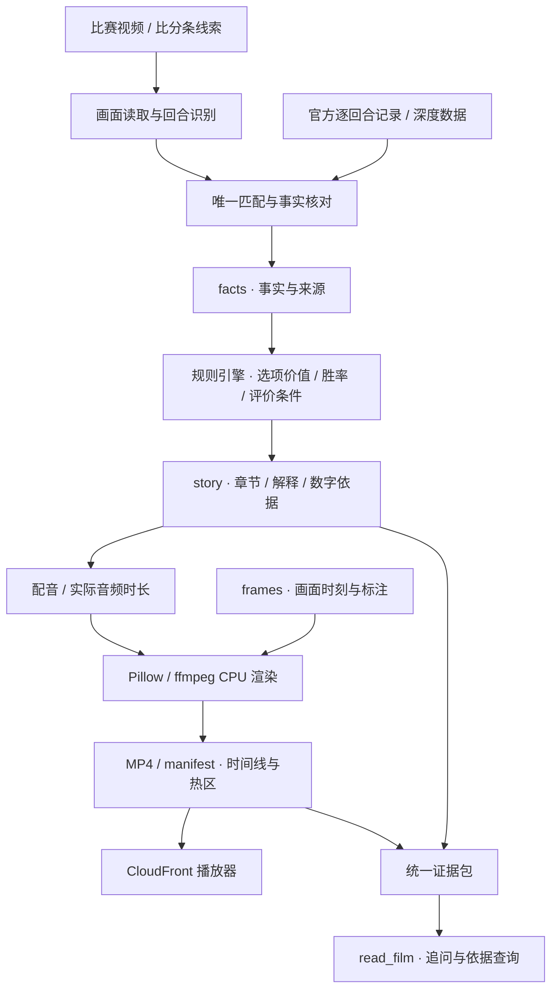

# CourtCast · 技术架构

[← 回到作品首页](../README.md) · [产品详解](PRODUCT.md) · [分析方法](ANALYSIS.md) · [工程与验证](ENGINEERING.md)

## 从比赛画面，到有依据的解释

CourtCast 将回合识别、统计计算、内容组织和视频渲染分别实现。**Amazon Bedrock AgentCore** 编排工具；规则引擎从统计表计算数值；渲染器将已有解释编排进画面；播放器与追问工具读取同一份成片依据。

图中是团队完整产品的职责划分。公开仓库随附的 v6 前端使用既有样例结果，完整后端与统计数据集不随此仓库分发。

## Agent 的四个工具

| 工具 | 输入与职责 | 输出与边界 |
| --- | --- | --- |
| `identify_play` | 从视频提取比分条与比赛线索，发起回合识别 | 保留匹配与不确定状态，不把模型读数直接当官方事实 |
| `find_play` | 按球队、节次、时钟、比分等线索检索官方记录 | 返回匹配候选与依据；无法唯一对齐时保留未知 |
| `make_film` | 接收视频，组织后台讲稿、配音和出片 | 先返回任务状态，后续查询已有进度或成片 |
| `read_film` | 只读已完成成片的讲稿、数字、球员资料和证据 | 答案来自既有结果；缺失内容不补写成事实 |

四个工具在基础设施代码中登记。工具编排不代替规则计算，成片追问也不另生成一套与画面冲突的数字。

## 数据交接与可追溯性

| 产物 | 保存什么 | 谁消费 |
| --- | --- | --- |
| `facts.json` | 对齐后的官方事实、画面观察、动作时刻与来源 | 规则引擎 |
| `story.json` | 选项价值、评价、章节、讲稿、字幕和数值依据 | 配音、渲染和交互页面 |
| `frames.json` | 原视频尺寸、比分条位置、关键帧与标注声明 | 渲染器 |
| `manifest.json` | 故事快照、成片章节与句子时刻、字幕、热区和回放位置 | 播放器与查片工具 |
| `courtcast.evidence.v1` | 官方、视觉、人工、估算来源与复核信息 | 分析台、发布检查与证据展示 |

这是语义上的交接关系，不要求每条输入都具备所有内容。证据不足时，流程可以只提供有依据的事实或原速片段，不凭空补出站位与因果关系。

### 四类信息分别表达

| 来源 | 在产品中的角色 |
| --- | --- |
| 官方比赛记录 | 比赛身份、人名、比分、事件与结果的核对基础 |
| 官方深度数据 | 描述实际出手和球员统计，保留原始口径 |
| 团队规则估算 | 比较选择与估算胜率，记录单位、公式、条件和误差 |
| 画面观察与标注 | 提供动作和位置依据，区分程序读取、人工复核和解释性示意 |

详细公式与统计范围见[分析方法](ANALYSIS.md)。

## 云端分为接单、计算和交付

| 模块 | 实现职责 |
| --- | --- |
| S3 / CloudFront | 浏览器直传、静态页面、证据与成片访问 |
| EventBridge / SQS FIFO | 上传事件入队，串行处理出片任务，重试与失败队列 |
| DynamoDB | 上传记录、状态与额度信息 |
| Lambda | 上传 API、识别、查球、讲解、查片与 CPU 渲染 |
| Bedrock / AgentCore | 画面理解与工具调用编排 |
| Gemini / Polly | 主配音与整片保底语音 |
| CloudWatch | 接单与处理指标、队列与函数告警 |
| AWS CDK | 六组资源：Uploads、Tools、Agent、API、Narrate、Site |

浏览器上传路径与 Agent 工具路径最终共享成片流程。最新前端契约围绕 `/api/uploads` 创建记录和查询状态；接口细节与历史验证见[工程与验证](ENGINEERING.md)。

代码中定义的最新配置与历史部署状态分别记录。2026-10-08 已有测试账号端到端成功案例；2026-10-10 的正式环境基线记录了六组资源创建和入口访问，但也记录了统一上传路由与前端版本尚需同步。因此，不能仅凭资源存在宣称最新全部链路均已正式验收。

## 视觉辅助与显示门槛

视觉链为画面定位、身份和 Overlay 提供辅助证据，主体分析围绕官方深度数据、回合对齐与自定义指标展开。

| 环节 | 实现 | 显示原则 |
| --- | --- | --- |
| 检测与跟踪 | RF-DETR、BoT-SORT / ByteTrack、OSNet | 检测、球队与轨迹分别保留置信信息 |
| 身份 | 多帧号码 OCR、球队、名单与上场约束 | `confirmed` 才显示实名；`probable` 与 `unknown` 保留各自状态 |
| 篮球轨迹 | 运动门控、短缺失插值、平滑 | 区分真实观测、插值与缺失 |
| 球场标定 | KaliCalib、光流与 RANSAC、切镜重置 | 保留原始与稳定坐标，拒绝异常跳点与界外投影 |
| Overlay | 各图层独立质量状态 | 人物、球、身份、球场与战术层分别决定是否可显示 |

自动身份链的已核对范围限定于 2025–26 HOU / DAL 样例。切镜会重置持球和运动历史；战术层不可用时清空旧图层，避免把上一帧的关系带到新镜头。

可显示帧比例、轨迹平滑程度属于稳定性代理指标。当前材料不足以把它们转写为准确率、完整逐帧真值或教练级连续战术复原。

## 原版 v6 前端如何实现

`demo/` 直接保留比赛期间迭代的 v6 文件，无需打包或安装运行依赖。

- `demo-data.js`：章节、样例数值与说明文案。
- `experience.js`：眼睛拼合、镜头过渡、选择揭晓、章节导航、位置联动及片尾动效。
- `experience.css`：暖金、深棕、象牙白设计变量，以及桌面布局和低高度适配。
- `assets/*.jpg`：原版比赛样例关键帧与眼睛拼图。
- `assets/*.svg`：原版品牌标志；字体嵌入样式。

脚本按顺序加载，兼容本地 `file://` 和普通静态服务器。交互状态包含开场、进入、幕间过渡、分析与收尾；首幕向上返回开场，片尾向上返回最后一幕。

图片与面板按可用高度收拢并居中。减少动态效果时直接切换场景；离开片尾取消篮球动画，重新进入时重新播放。本轮工程文档补充保留这些前端文件和素材原样。

## 展示与运行范围

| 本仓库可以直接体验 | 需要独立后端与数据环境 |
| --- | --- |
| 眼睛开场与五幕导航 | 真实视频上传与识别 |
| 观众选择与估算揭晓 | 官方数据查询和回合核对 |
| 标注联动与关键时刻回看 | 规则计算、讲稿、配音与成片 |
| 自动导览、键盘与减少动态效果 | Agent 工具与成片证据查询 |

片尾原跳转页与已有图片一并保留；其历史 `film.mp4` 和 `eye_monk.mp4` 不在原素材中。原外链仍沿用当时配置，不据此声明当前云服务可用。

本仓库不附带原始转播视频、模型权重、云账号配置或凭据。字体附 SIL OFL；公开展示不改变第三方赛事资料与标识的权利归属，也不是项目级开源许可声明。
