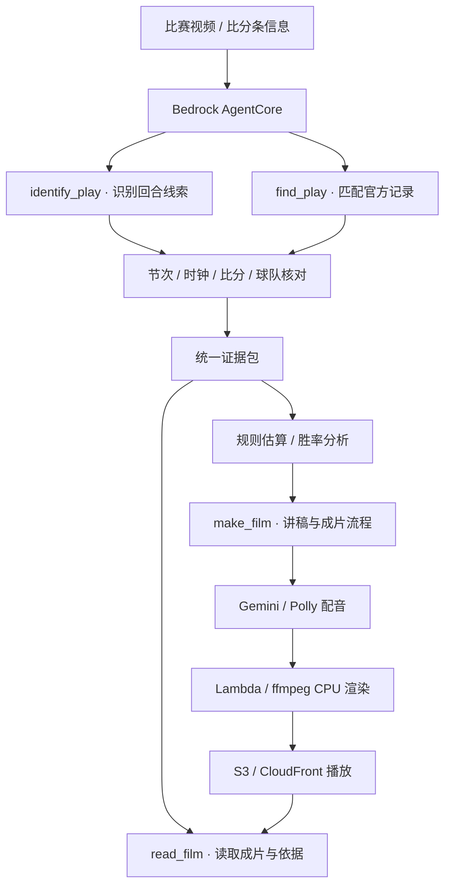

# CourtCast · 技术架构

[← 回到作品首页](../README.md) · [产品详解](PRODUCT.md)

## 一条函数链，一个 Agent

团队比赛方案将视频输入、回合对齐、证据组织、讲稿配音和出片分为明确步骤，由 **Amazon Bedrock AgentCore** 编排工具调用。

上图表达团队路演的职责划分，不是本公开仓库向外提供的可直接调用 API 定义。

## 工具职责

| 工具 | 职责 |
| --- | --- |
| `identify_play` | 从视频与比分条信息中提取用于认球的线索 |
| `find_play` | 在官方比赛记录中寻找并核对对应回合 |
| `make_film` | 组织讲稿、配音和出片流程 |
| `read_film` | 读取成片结果及其对应的分析依据 |

工具之间传递经过对齐的数据与证据，避免各个环节分别猜测比赛身份或重复生成不一致的数字。

## 云端模块

| 模块 | 团队比赛方案 |
| --- | --- |
| 上传与访问 | Amazon S3、Amazon CloudFront |
| 调度与状态 | EventBridge、SQS、DynamoDB |
| 认球与模型调用 | Amazon Bedrock、Bedrock AgentCore |
| 规则计算与服务逻辑 | AWS Lambda |
| 讲稿与配音 | 讲稿检查器、Gemini、Amazon Polly |
| 视频渲染 | ffmpeg、CPU 渲染流程 |
| 基础设施定义 | AWS CDK |

此处记录比赛产品的整体路线；公开仓库没有附带云服务部署、账号配置或推理凭据。

## 数据如何成为一句解说

1. **读取线索。** 从比赛画面提取比分条等认球信息。
2. **核对官方记录。** 对齐节次、时钟、比分、球队和结果；能够唯一匹配后再进入解读。
3. **构造证据包。** 将官方事实、官方深度数据、规则估算与人工观察分别记录。
4. **计算并保留边界。** 对决策、胜率等信息进行分析，同时保留假设、样本与误差口径。
5. **组织讲稿。** 围绕回合的问题形成解释，让人名、数字、字幕与画面对应。
6. **配音和出片。** 将解释与标注编排到视频时间线上，交付可播放的讲解片。

### 四类信息来源

| 来源 | 表达原则 |
| --- | --- |
| 官方比赛记录 | 作为比赛身份、人名、比分与结果的核对基础 |
| 官方深度数据 | 标注原始口径，指向对应球员与时刻 |
| 团队规则估算 | 显式说明单位、假设和误差，避免冒充官方决策评分 |
| 人工观察与标注 | 标明看帧来源，不包装成实时自动追踪 |

## 原版 v6 前端如何实现

`demo/` 直接使用比赛期间迭代的 v6 前端文件，无需打包或安装运行依赖。

- `demo-data.js`：章节、样例数值与说明文案。
- `experience.js`：眼睛拼合、镜头过渡、选择与揭晓、章节导航、位置联动及片尾动效。
- `experience.css`：暖金、深棕、象牙白设计变量，以及桌面布局和低高度适配。
- `assets/*.jpg`：原版使用的比赛样例关键帧与眼睛拼图。
- `assets/*.svg`：原版品牌标志。
- 字体嵌入样式，脚本按顺序加载，兼容本地 `file://` 和普通静态服务器。

交互状态包含开场、进入、幕间过渡、分析与收尾。五幕共用导航顺序；首幕向上返回开场，片尾向上返回最后一幕。决策结果可以在切换和回看时保留。

图片与面板根据实际可用高度收拢并居中。减少动态效果时直接切换场景；离开片尾会取消篮球动画，重新进入时重新播放。

## 展示范围

| 这里可以直接体验 | 团队比赛产品的云端职责 |
| --- | --- |
| 眼睛开场与五幕导航 | 真实视频输入与回合识别 |
| 观众选择与估算揭晓 | 官方数据查询和回合核对 |
| 球场标注与路线联动 | 讲稿生成、配音与 ffmpeg 出片 |
| 来源说明与关键时刻回看 | Agent 工具调用与证据读取 |
| 自动导览、键盘和减少动态效果 | 云端队列、任务状态与成片交付 |

原版前端使用比赛样例图片、既有标注与估算结果。它保留当时的产品表达和交互方式，不在静态页面中重新执行视频识别或云端推理；前端体验不能替代后端、数据模型或部署的验收。

## 公开内容与素材

本次按原版 v6 页面随附其使用的比赛样例图片与眼睛拼图，不附带原始转播视频、模型权重或云端凭据。片尾跳转目标的历史页面与已有图片一并保留；其 `assets/film.mp4` 和 `assets/eye_monk.mp4` 不在原素材中，外链仍由原部署提供。

字体附带 SIL OFL 许可证。公开展示不是项目级开源许可声明，也不改变第三方赛事资料和标识的权利归属。
