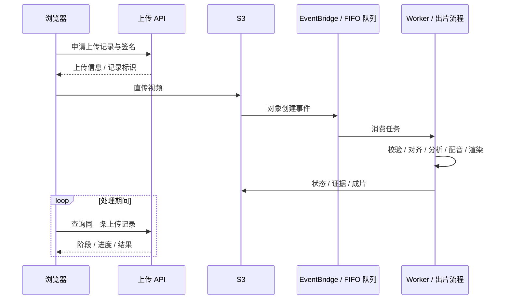

# CourtCast · 工程与验证

[← 回到作品首页](../README.md) · [产品详解](PRODUCT.md) · [技术架构](ARCHITECTURE.md) · [分析方法](ANALYSIS.md)

## 从上传到可播放结果

讲解片的生成需要跨越上传、识别、取数、讲稿、配音和编码。CourtCast 将这条长流程放到后台，浏览器和 Agent 接收任务状态，不持续等待一次同步请求完成整段视频。

最新上传代码使用 `/api/uploads` 统一创建与查询流程。旧的拆分任务接口不再作为前端主链路；这避免页面与后台各自维护一套不一致的作业状态。

| 接口 | 最新实现职责 |
| --- | --- |
| `POST /api/uploads` | 创建记录、校验申报信息并返回 S3 表单签名 |
| `GET /api/uploads/{day}/{id}` | 返回处理阶段、分析摘要、证据与成片状态 |
| `POST /api/uploads/{day}/{id}/review` | 持创建者复核凭据保存比赛、球员、数字和成片检查 |
| `POST /api/ask` | 调用 Agent，查询回合或成片内容 |

这里描述团队后端代码的契约；本仓库的 GitHub Pages 仅提供 v6 静态展示，不提供这些 API。

## 长任务如何稳定交付

| 机制 | 解决的问题 |
| --- | --- |
| S3 直传 | 视频数据不经过网页 API 中转，上传进度可以直接显示 |
| 服务端再校验 | Worker 检查真实对象大小、媒体流和时长，不只相信浏览器声明 |
| FIFO 串行出片 | 同一分组一次完成一个任务，控制长任务并发与资源占用 |
| 重复事件检查 | 已完成任务复用已有状态，避免事件重投导致重复成片 |
| 重试与失败队列 | 网络与限流错误交回队列重试，业务校验失败明确结束 |
| 刷新后恢复 | 浏览器保留记录标识，继续查询原任务 |
| CloudWatch | 记录接单、成功、失败、重试；代码定义队列积压、失败队列、函数错误与耗时告警 |
| 生命周期清理 | 历史测试配置对输入、任务与成片对象设置一天清理策略 |

这些是源码中可以核对的机制。监控和统一接口的最新实现，不等同于每项配置都已在最终正式环境完成复测。

## 证据是数据的一部分

统一证据包采用 `courtcast.evidence.v1`。官方事实、视觉读取、人工观察和规则估算保留各自来源，讲稿、画面和追问从同一份依据读取。

数字详情可以包含原始统计、样本数、收缩参数、公式和源文件散列。成片清单记录每章、每句、字幕与标注的时间，帮助把一句解说追溯回具体画面。

发布检查将比赛、球员、指标和成片分开记录。复核状态由持创建者凭据的检查请求保存；后台成功出片与人工确认内容正确分别表达。

三个登记样例的分析缓存按 **视频 SHA-256 精确匹配**。陌生视频走真实上传处理；纯静态环境没有后端时明确停止，不能用一段已知视频的结果套在另一段视频上。

## 配音、字幕和镜头共用时间线

渲染器读取已有故事、原视频与标注，使用 Pillow / ffmpeg 生成 MP4 和播放清单，不在渲染阶段另算篮球结论。

- **实际声音决定时长。** 按 WAV 帧数读取音频长度，让口播、字幕和标注共用时间基准。
- **先规划再编码。** 在渲染前检查文本容量与片段时间，避免为装不下的内容先合成声音、再反复重出。
- **画面尊重转播信息。** 字幕避让比分条，球员标签和数字卡按场上位置安排；运动段与定格段分别处理标记。
- **配音保持一致。** 语音缓存包含文字、模型、音色等条件；主配音有缺句时整片切换保底声音，避免一条片混用不一致音色。
- **交互读取同一清单。** 章节、透明热区、数字详情与回看共用渲染产物；样例多视角切换保留对应章节位置与播放状态。

不同时间线版本的节奏有迭代差异，以上描述共同工程机制；不把某批原声字幕验证片描述为已生成新的解释配音。

## 已有验证记录

以下是团队仓库保留的历史记录，不是这次文档更新重新执行的后端测试。

| 日期 / 范围 | 记录中的成果 | 证明范围 |
| --- | --- | --- |
| 2026-10-02 · 胜率参数表 | 1,230 场、212,267 个状态；整体十分箱最大偏差 2.1 个百分点 | 历史语料校准；无独立留出集，见[分析方法](ANALYSIS.md) |
| 引擎逻辑检查 | 8,000 种局面的结果独立性检查 | 验证进没进不改变机会与选择评价；不代表视觉或战术准确率 |
| 官方记录反查 | 四场、739 次已知出手；无比赛编号条件下匹配 722 次，保留 17 次未知，已匹配项未见错配 | 线索由官方记录构造，验证查找逻辑；不是端到端读视频准确率 |
| 2026-10-08 · 测试 AWS 账号 | 陌生视频从浏览器上传，到官方回合唯一对齐、配音、Lambda 出片和网页播放的成功案例 | 历史真实云端链路；该测试账号已被主办方收回 |
| 2026-10-09 · 局部回归 | 引擎 131 项、渲染 80 项、打包讲解流程 33 项；另有路由模拟与 CDK 离线合成检查 | 当批本地与模拟服务验证，没有新增真实云请求 |
| 2026-10-09 · 视角样例 | 三个样例、三种视角，共九段原声字幕验证片 | 覆盖样例组织与播放器交互；该批未新增解释配音请求 |

### 一次链路耗时记录

2026-10-08，测试账号对一段 **4.3 MB / 22.9 秒**视频记录了以下耗时：

| 阶段 | 记录值 |
| --- | ---: |
| 上传 | 43.2 秒 |
| AWS 识别 | 4.8 秒 |
| 故事生成 | 0.1 秒 |
| Polly 配音 | 0.6 秒 |
| 上传完成后可在原视频上查看分析 | 约 6 秒 |
| 后台 1080p 成片生成 | 约 40.9 秒 |
| 全过程完成 | 约 93.9 秒 |

各阶段可能重叠，不能简单求和。这是一次特定网络、视频和账号下的样本，说明「先返回分析、后台继续成片」的交付方式，不作为性能基准或服务承诺。

## 本公开仓库的验收边界

| 层次 | 这里交付什么 |
| --- | --- |
| 可直接使用 | 原版 v6 前端、眼睛开场、五幕交互、选择揭晓、标注联动、片尾原跳转 |
| 可公开阅读 | 产品、架构、计算方法、参数摘要、历史验证范围 |
| 独立云端能力 | 上传、识别、官方数据查询、配音与出片，依赖团队后端及账号 |
| 独立内容验收 | 实际视频画面、球员身份、坐标、解说质量和正式环境发布状态 |

视觉模块的稳定性代理指标与人工真值指标分开记录。没有完整人工复核时，不将轨迹更平滑、可显示帧更多，写成识别准确率更高。

本页依据团队交付检查、上传接口与 Worker、云契约测试及成片交付记录整理，核对日期为 2026-10-20。未公开账号标识、内部作业记录、复核凭据、访问密钥或受限媒体。
